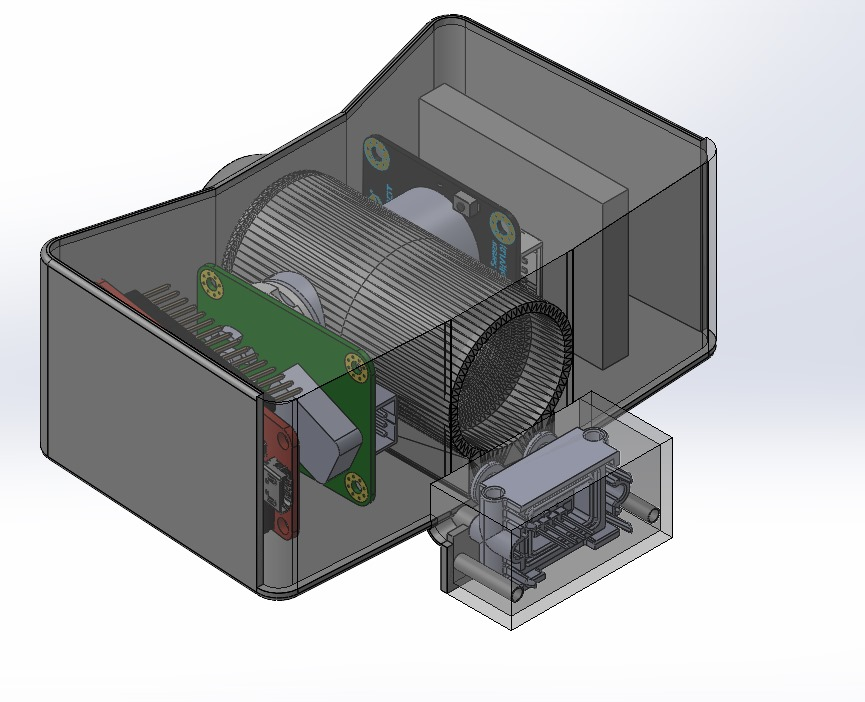
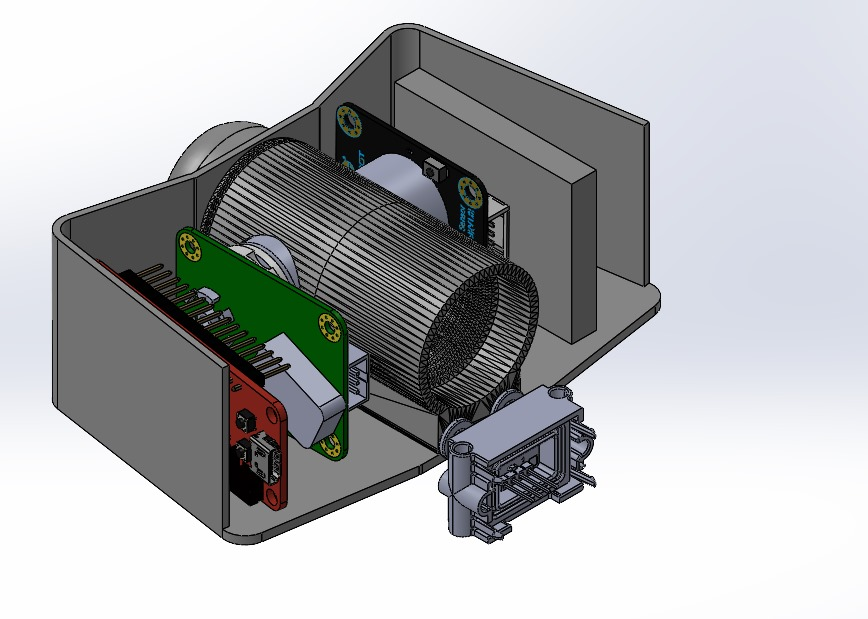

## Project Overview

This project developed a portable prototype for monitoring oxygen-consumption and carbon-dioxide-production signals used in metabolic assessment. The work connected a custom enclosure, Arduino-based sensor acquisition, Bluetooth Low Energy communication, and a MATLAB interface into one data-collection workflow.

The design brings together the sensing elements needed for a VO2/VCO2 measurement pipeline: airflow characterization, oxygen concentration, and carbon-dioxide concentration.

## Enclosure and System Integration

The CAD concept positions the monitor at the user interface, while the enclosure design packages airflow hardware, gas sensors, embedded electronics, and portable power into one system.

<figure class="portfolio-project__media portfolio-project__media--wide">
  
</figure>

The open-shell view shows the internal arrangement of the sensing hardware, controller electronics, and airflow components before the top enclosure is installed.

<figure class="portfolio-project__media portfolio-project__media--wide">
  
</figure>

## Sensor and IoT Architecture

| Component | Role in the prototype |
|---|---|
| Arduino-compatible IoT microcontroller | Acquires sensor data, coordinates embedded processing, and supports connected data workflows. |
| Sensirion SDP816-125Pa differential-pressure sensor | Captures the pressure signal used to characterize airflow through the measurement path. |
| Sensirion SCD30 CO2 sensor | Measures carbon-dioxide concentration. |
| Gravity I2C oxygen sensor | Measures oxygen concentration through the I2C sensor interface. |
| Battery | Enables self-contained portable operation. |
| Breadboard | Supports early electronics integration and sensor-interface testing. |

The sensor suite provides synchronized airflow, oxygen, and CO2 signals for embedded processing. The Arduino-based controller packages measurements for wireless transfer, while MATLAB provides the host-side interface for observation and analysis.

## Engineering Focus

- Integrated airflow and gas-sensing requirements into a compact mechanical package.
- Selected a sensor suite that captures the primary physical quantities relevant to VO2/VCO2 analysis.
- Established an Arduino IoT architecture for embedded acquisition, BLE communication, and connected data workflows.
- Designed the enclosure around internal electronics, airflow routing, and portable power.
- Developed a component-level bill of materials to support sourcing and prototype assembly.

## My Contributions

- Designed the prototype packaging and component layout in CAD.
- Implemented Arduino-based embedded code for sensor acquisition and communication.
- Integrated BLE for wireless transfer of live measurements.
- Developed the MATLAB-side interface for receiving and displaying the data.

## System Workflow

The embedded device acquires the gas-related sensor channels, packages the measurements, and transmits them over BLE. MATLAB receives the stream and provides the host-side interface for real-time observation and subsequent analysis.

## Outcome

The project established an end-to-end prototype from sensing hardware to wireless visualization. Additional public design files and quantified validation results are not currently included with this portfolio entry, so the page intentionally limits its claims to the implemented architecture and demonstrated data path.

## Design Context

The project was informed by the packaging and integration challenges associated with portable metabolic-monitoring devices. Its emphasis is system integration: translating sensing requirements into an embedded, mechanically packaged, and IoT-ready hardware architecture.

## Bill of Materials

The complete component list is available in the [project bill of materials](/assets/Projects/VO2VCO2/BOM.xlsx).
