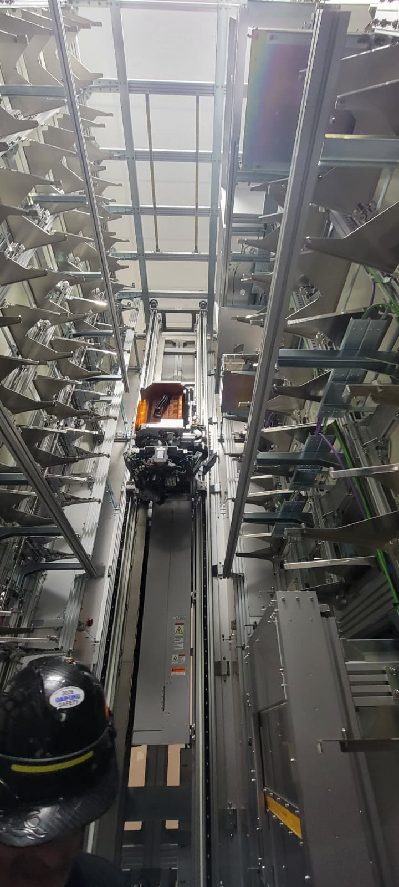
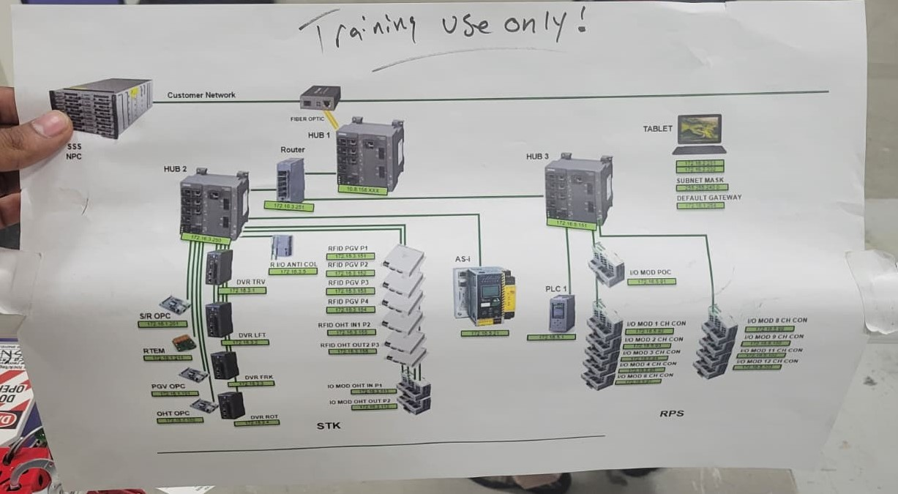

I am participating in the **Daifuku Automated Material Handling Systems (AMHS) Microcredential**, an Arizona State University program focused on the automation technologies that move, store, and coordinate materials inside semiconductor manufacturing facilities.

The program connects robotics and industrial automation concepts with the operational systems that enable high-throughput semiconductor fabrication.

## AMHS in Semiconductor Manufacturing

Automated Material Handling Systems are essential to modern fabs. They coordinate the transport and storage of production materials, connect equipment to manufacturing systems, and support the reliable, safe movement of material across complex facilities.

The microcredential examines the role of AMHS in advanced manufacturing, with emphasis on system operation, equipment communication, safety, and the integration of automation technologies into production workflows.

## How an AMHS Moves Material

At a high level, the manufacturing system requests a wafer container, or **FOUP** (front-opening unified pod), from storage. The stocker retrieves the requested FOUP from its assigned location and delivers it to a transfer point. A conveyor or other transport mechanism then carries the FOUP to the next station, where the movement is confirmed through the automation and control network.

<figure class="portfolio-project__media" style="max-width: 28rem;">
  
  <figcaption>Inside an automated stocker: the retrieval mechanism accesses FOUP storage locations and moves the requested container to a handoff point.</figcaption>
</figure>

The transfer system provides the physical handoff between storage and production operations. It receives the container, moves it along the defined route, and presents it to the next process or staging location.

<video width="300" controls playsinline preload="metadata" style="display: block; width: 300px; max-width: 100%; height: auto; margin: 1.5rem 0;">
  <source src="/assets/04_BlogPosts/07_Daifuku_AMHS/02_conveyor_systems_that_grabs_Foup_from-bot_transports.mp4" type="video/mp4">
  Your browser does not support the video tag.
</video>

<figure class="portfolio-project__media portfolio-project__media--wide">
  
  <figcaption>AMHS communication network used for training, connecting supervisory systems with controllers, drives, RFID, I/O modules, and operator interfaces.</figcaption>
</figure>

Behind the motion, the communication network coordinates transport requests, equipment states, routing, identification, and fault information. This is what allows material handling to operate as part of the larger manufacturing system rather than as an isolated machine.

## Learning Focus

The microcredential introduces:

- AMHS fundamentals and semiconductor-manufacturing applications
- Automated stocker architecture and equipment components
- Communication pathways between AMHS equipment and manufacturing systems
- Automated track systems and material transport
- Safety and industry best practices for advanced manufacturing

## Connecting Robotics to Factory-Scale Automation

Robotics in semiconductor manufacturing extends beyond an individual manipulator or autonomous vehicle. It depends on coordinated systems that combine material flow, sensing, equipment communication, storage, safety, and manufacturing execution.

This microcredential offers a valuable view of how those systems operate at factory scale and how industrial robotics, smart manufacturing, and semiconductor automation converge in practice.

## Related Resources

- [Daifuku Cleanroom AMHS Solutions](https://www.daifuku.com/solution/cleanroom/)
- [ASU Microelectronics Workforce Development](https://microelectronics.asu.edu/workforce-development/)
- [ASU MacroTechnology Works](https://microelectronics.asu.edu/macrotechnology-works/)
